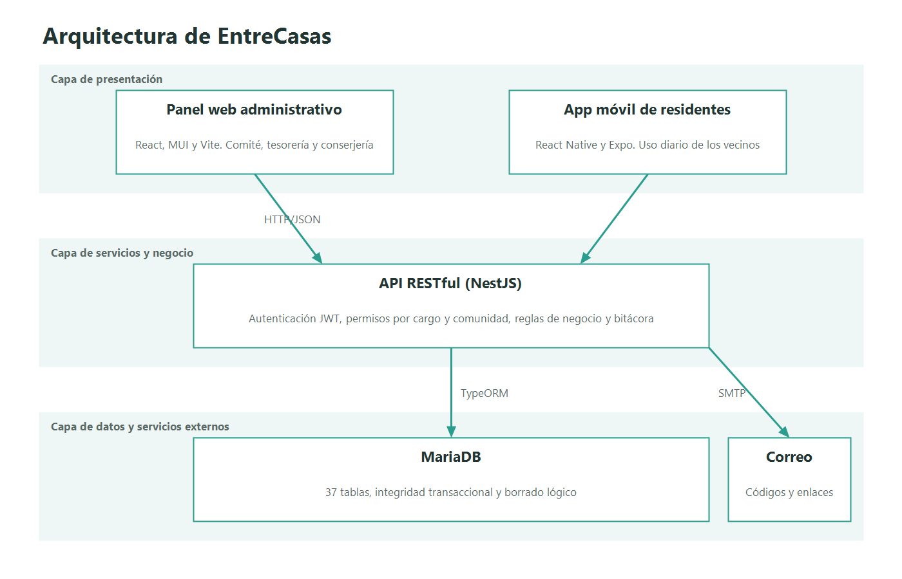

# Arquitectura

EntreCasas usa una arquitectura en capas, con un backend modular único que expone una API RESTful.

| Capa | Componente | Tecnología | Responsabilidad |
|---|---|---|---|
| Presentación | Panel web | React, MUI, Vite | Administración, tesorería, directiva y conserjería |
| Presentación | App móvil | React Native, Expo | Uso diario de los residentes |
| Servicios | API RESTful | NestJS, TypeORM | Autenticación, permisos y reglas de negocio |
| Datos | Base de datos | MariaDB | Persistencia e integridad transaccional |
| Externo | Correo | SMTP | Códigos de acceso, enlaces de contraseña, recordatorios de cobro y comunicados |

## Módulos del backend
| Módulo | Responsabilidad | Estado |
|---|---|---|
| `auth` | Login con contraseña o código, perfil, recuperación de contraseña y tutoriales vistos | Implementado |
| `solicitudes-acceso` | Solicitudes de vecinos y su aprobación o rechazo | Implementado |
| `plataforma` | Comunidades, módulos, tipo, alta con unidades y responsable, y bitácora de plataforma | Implementado |
| `unidades` | Lista con ocupantes, creación en lote y corrección de número | Implementado |
| `residentes` | Padrón, invitaciones, cargos, desactivación y reactivación | Implementado |
| `usuarios` | Cuentas, membresías y residencias compartidas por los demás módulos | Implementado |
| `comunidad` | Guía de bienvenida y contactos de la comunidad | Implementado |
| `hogar` | Fichas de Mi hogar y su mantención | Implementado |
| `finanzas` | Categorías, cobros, pagos, avisos, morosidad, egresos, exenciones y reportes | Implementado |
| `muro` | Publicaciones de vecinos, comunicados y normas con aprobación, reportes y moderación | Implementado |
| `bitacora` | Registro de auditoría y consulta para la Presidencia y la Administración | Implementado |
| `mail` | Envío de correos y destinatarios de la comunidad | Implementado |
| `roles` | Valida al iniciar que los cargos coincidan con la base de datos | Implementado |
| `common` | Guards, filtro de errores, pipes, validadores y utilidades | Implementado |
| `reservas` | Espacios comunes con sus horarios, reservas, cancelaciones y entrega y recepción en conserjería | Implementado |
| `redes-vecinales` | Datos de la comunidad: cuenta de transferencia y umbral de visado | Plantilla por implementar |
| Marketplace, votaciones y actas, invitaciones QR | App móvil y directiva | Por implementar |

## Decisiones
- **Multi-comunidad:** cada petición indica su comunidad con el header `X-Red-Id`. El JWT solo lleva el usuario, y los cargos se consultan en cada petición para que los cambios apliquen al instante.
- **Autorización por cargo:** `JwtAuthGuard` y `RolesGuard` protegen las rutas según cargo y módulo activo.
- **Borrado lógico:** los registros no se eliminan físicamente.
- **Sin pasarela de pago:** los pagos se registran manualmente.
- **Contrato de la API:** las respuestas usan camelCase y DTO de salida explícitos, nunca la entidad de la base de datos.
- **Formato único de errores:** `{ statusCode, codigo, mensaje, campos?, idSolicitud }`, con mensajes en español y un `codigo` fijo para que el frontend decida qué hacer.
- **Listas paginadas por cursor:** las listas largas, como la bitácora y el muro, reciben `antesDe` y `limite` y devuelven `siguiente`.

## Estado de la integración
La API y la base de datos ya están conectadas. El panel web y la app móvil aún usan datos de prueba; su conexión a la API está pendiente.
