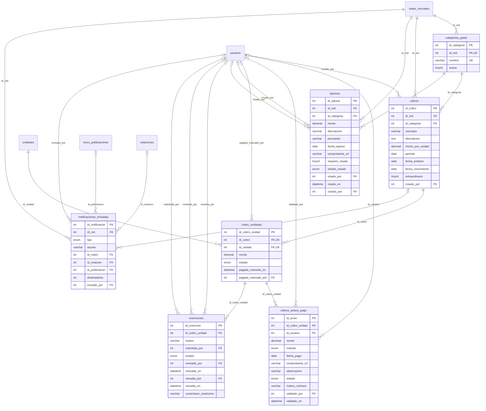
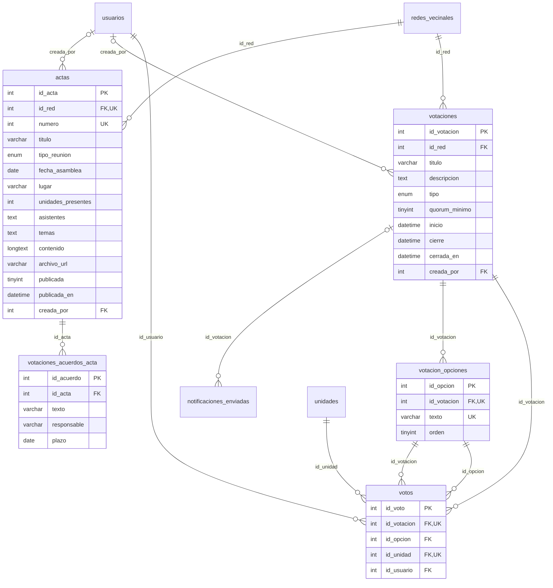
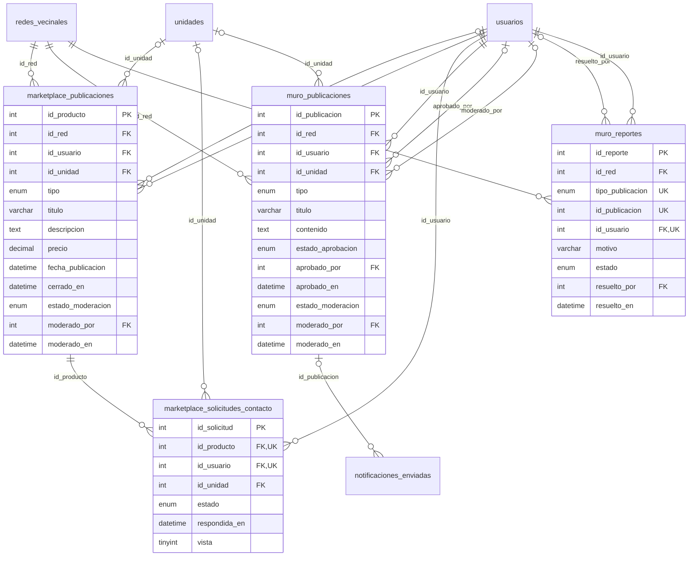
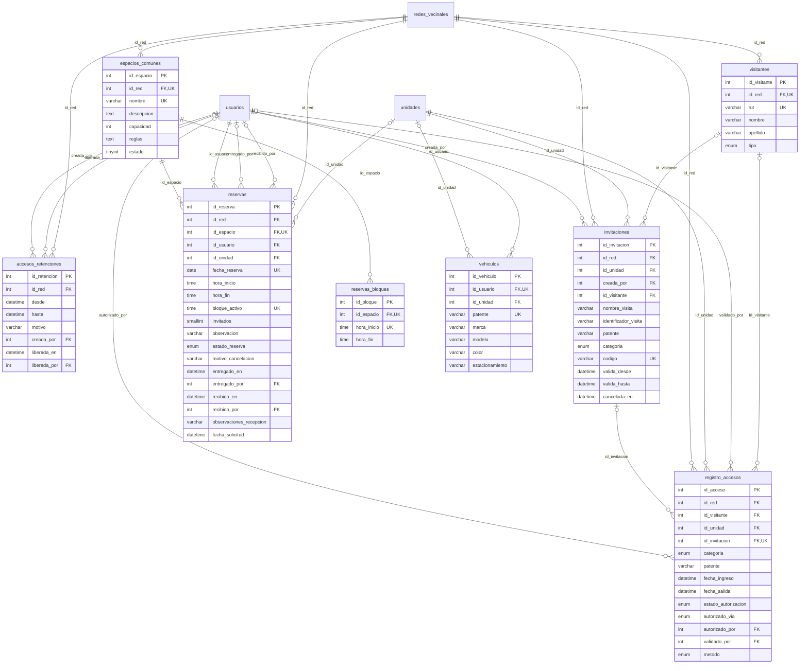

# Modelo de datos

El modelo se implementa en MariaDB (`bd/entrecasas_db.sql`) y tiene **40 tablas** y **96 llaves foráneas**. Los diagramas entidad-relación de este documento se generaron desde el esquema real de la base de datos, consultando `information_schema`, el 16 de noviembre de 2026. Por claridad omiten las tres fechas de auditoría que tiene cada tabla: `fecha_creacion`, `fecha_actualizacion` y `fecha_eliminacion`.

Convenciones: **PK** es llave primaria, **FK** es llave foránea y **UK** es valor único. En las relaciones, `||--o{` es una llave foránea obligatoria (NOT NULL) y `|o--o{` una opcional (NULL permitido); la etiqueta de cada relación es la columna que la implementa. Cada diagrama de área incluye las relaciones de su área, por lo que también aparecen tablas de otras áreas relacionadas con ella.

Las mismas figuras están exportadas como imagen en la carpeta [diagramas](diagramas/):

| Diagrama | Imagen |
|---|---|
| Vista general (40 tablas y sus relaciones) | [er-general.png](diagramas/er-general.png) |
| Identidad y acceso | [er-identidad-y-acceso.png](diagramas/er-identidad-y-acceso.png) |
| Comunidad | [er-comunidad.png](diagramas/er-comunidad.png) |
| Finanzas | [er-finanzas.png](diagramas/er-finanzas.png) |
| Directiva | [er-directiva.png](diagramas/er-directiva.png) |
| Muro y marketplace | [er-muro-y-marketplace.png](diagramas/er-muro-y-marketplace.png) |
| Reservas y accesos | [er-reservas-y-accesos.png](diagramas/er-reservas-y-accesos.png) |

## Reglas principales
- Un usuario tiene un cargo por fila en `membresias` y una vivienda por fila en `residencias`.
- Cada dato de una comunidad se asocia a `redes_vecinales`.
- Los registros se eliminan con borrado lógico mediante `fecha_eliminacion`.
- `muro_reportes.id_publicacion` no tiene llave foránea, porque apunta al muro o al marketplace según `tipo_publicacion`.
- En el muro y el marketplace, que el autor borre una publicación es un borrado lógico (`fecha_eliminacion`); que la oculte un moderador es `estado_moderacion` = 'Oculta', con `moderado_por` y `moderado_en`.
- `hogar_fichas` pertenece a la unidad: solo la ven y editan sus residentes vigentes.
- Cada vivienda tiene como máximo un titular: `residencias.titular` vale 1 o NULL, y el UNIQUE (`id_unidad`, `titular`) no deja dos titulares en la misma unidad. Vota el titular, y `votos` permite un voto por vivienda con el UNIQUE (`id_votacion`, `id_unidad`).
- En `reservas`, `bloque_activo` es una columna calculada que vale `hora_inicio` mientras la reserva está Pendiente o Aprobada, y su UNIQUE (`id_espacio`, `fecha_reserva`, `bloque_activo`) impide dos reservas activas en el mismo bloque. «En uso» y «Devuelto» no son estados: salen de `entregado_en` y `recibido_en`.
- Un espacio común dado de baja queda con `estado` = 0 y su nombre es único en la comunidad (`uq_espacio_red_nombre`), para reactivarlo si se vuelve a agregar.
- `solicitudes_acceso` guarda el consentimiento del aviso de privacidad: `privacidad_aceptada_en` (hora del servidor) y `version_privacidad` (versión del aviso que aceptó la persona).
- `auth_cambios_correo` guarda el pedido de cambio de correo con el HMAC del código de verificación, su vencimiento y los intentos usados; el correo de la cuenta solo cambia al confirmar el código.
- `accesos_retenciones` suspende la anonimización de los registros de acceso de una comunidad entre `desde` y `hasta` cuando hay un `motivo` para conservarlos (por ejemplo, una investigación), como exige la Ley 21.719; guarda quién la creó (`creada_por`) y quién la liberó (`liberada_por`, `liberada_en`).
- Las unidades son únicas por comunidad, torre y número con la columna calculada `torre_clave` y el UNIQUE `uq_unidad_red_torre_numero`: dos torres pueden tener cada una su 101.

## Vista general

```mermaid
erDiagram
    usuarios |o--o{ accesos_retenciones : ""
    redes_vecinales ||--o{ accesos_retenciones : ""
    usuarios |o--o{ actas : ""
    redes_vecinales ||--o{ actas : ""
    usuarios ||--o{ auth_cambios_correo : ""
    redes_vecinales |o--o{ bitacora_auditoria : ""
    usuarios |o--o{ bitacora_auditoria : ""
    redes_vecinales ||--o{ categorias_gasto : ""
    categorias_gasto ||--o{ cobros : ""
    usuarios |o--o{ cobros : ""
    redes_vecinales ||--o{ cobros : ""
    cobro_unidades ||--o{ cobros_avisos_pago : ""
    usuarios |o--o{ cobros_avisos_pago : ""
    cobros ||--o{ cobro_unidades : ""
    usuarios |o--o{ cobro_unidades : ""
    unidades ||--o{ cobro_unidades : ""
    usuarios ||--o{ codigos_otp : ""
    redes_vecinales ||--o{ comunidad_contactos : ""
    usuarios |o--o{ comunidad_guias : ""
    redes_vecinales ||--o{ comunidad_guias : ""
    categorias_gasto ||--o{ egresos : ""
    usuarios |o--o{ egresos : ""
    redes_vecinales ||--o{ egresos : ""
    redes_vecinales ||--o{ espacios_comunes : ""
    cobro_unidades ||--o{ exenciones : ""
    usuarios |o--o{ exenciones : ""
    usuarios |o--o{ hogar_fichas : ""
    unidades ||--o{ hogar_fichas : ""
    usuarios |o--o{ invitaciones : ""
    redes_vecinales ||--o{ invitaciones : ""
    unidades ||--o{ invitaciones : ""
    visitantes |o--o{ invitaciones : ""
    usuarios |o--o{ marketplace_publicaciones : ""
    redes_vecinales ||--o{ marketplace_publicaciones : ""
    unidades |o--o{ marketplace_publicaciones : ""
    marketplace_publicaciones ||--o{ marketplace_solicitudes_contacto : ""
    unidades |o--o{ marketplace_solicitudes_contacto : ""
    usuarios ||--o{ marketplace_solicitudes_contacto : ""
    redes_vecinales ||--o{ membresias : ""
    roles ||--o{ membresias : ""
    usuarios ||--o{ membresias : ""
    usuarios ||--o{ muro_publicaciones : ""
    redes_vecinales ||--o{ muro_publicaciones : ""
    unidades |o--o{ muro_publicaciones : ""
    redes_vecinales ||--o{ muro_reportes : ""
    usuarios |o--o{ muro_reportes : ""
    cobros |o--o{ notificaciones_enviadas : ""
    usuarios |o--o{ notificaciones_enviadas : ""
    muro_publicaciones |o--o{ notificaciones_enviadas : ""
    redes_vecinales ||--o{ notificaciones_enviadas : ""
    votaciones |o--o{ notificaciones_enviadas : ""
    usuarios |o--o{ redes_vecinales : ""
    usuarios |o--o{ red_modulos : ""
    modulos ||--o{ red_modulos : ""
    redes_vecinales ||--o{ red_modulos : ""
    usuarios |o--o{ registro_accesos : ""
    invitaciones |o--o{ registro_accesos : ""
    redes_vecinales ||--o{ registro_accesos : ""
    unidades ||--o{ registro_accesos : ""
    visitantes |o--o{ registro_accesos : ""
    espacios_comunes ||--o{ reservas : ""
    usuarios ||--o{ reservas : ""
    redes_vecinales ||--o{ reservas : ""
    unidades |o--o{ reservas : ""
    espacios_comunes ||--o{ reservas_bloques : ""
    unidades ||--o{ residencias : ""
    usuarios ||--o{ residencias : ""
    redes_vecinales ||--o{ solicitudes_acceso : ""
    usuarios |o--o{ solicitudes_acceso : ""
    unidades |o--o{ solicitudes_acceso : ""
    usuarios ||--o{ tokens_password : ""
    redes_vecinales ||--o{ unidades : ""
    unidades |o--o{ vehiculos : ""
    usuarios ||--o{ vehiculos : ""
    redes_vecinales ||--o{ visitantes : ""
    usuarios |o--o{ votaciones : ""
    redes_vecinales ||--o{ votaciones : ""
    actas ||--o{ votaciones_acuerdos_acta : ""
    votaciones ||--o{ votacion_opciones : ""
    votacion_opciones ||--o{ votos : ""
    unidades ||--o{ votos : ""
    usuarios ||--o{ votos : ""
    votaciones ||--o{ votos : ""
```

## Identidad y acceso

```mermaid
erDiagram
    usuarios |o--o{ accesos_retenciones : "creada_por"
    usuarios |o--o{ accesos_retenciones : "liberada_por"
    usuarios |o--o{ actas : "creada_por"
    usuarios ||--o{ auth_cambios_correo : "id_usuario"
    usuarios |o--o{ bitacora_auditoria : "id_usuario"
    usuarios |o--o{ cobros : "creado_por"
    usuarios |o--o{ cobros_avisos_pago : "id_usuario"
    usuarios |o--o{ cobros_avisos_pago : "validado_por"
    usuarios |o--o{ cobro_unidades : "pagado_marcado_por"
    usuarios ||--o{ codigos_otp : "id_usuario"
    usuarios |o--o{ comunidad_guias : "actualizado_por"
    usuarios |o--o{ egresos : "creado_por"
    usuarios |o--o{ egresos : "visado_por"
    usuarios |o--o{ exenciones : "resuelta_por"
    usuarios |o--o{ exenciones : "revisada_por"
    usuarios |o--o{ exenciones : "solicitada_por"
    usuarios |o--o{ hogar_fichas : "creado_por"
    usuarios |o--o{ invitaciones : "creada_por"
    usuarios |o--o{ marketplace_publicaciones : "moderado_por"
    usuarios ||--o{ marketplace_publicaciones : "id_usuario"
    usuarios ||--o{ marketplace_solicitudes_contacto : "id_usuario"
    redes_vecinales ||--o{ membresias : "id_red"
    roles ||--o{ membresias : "id_rol"
    usuarios ||--o{ membresias : "id_usuario"
    usuarios ||--o{ muro_publicaciones : "id_usuario"
    usuarios |o--o{ muro_publicaciones : "aprobado_por"
    usuarios |o--o{ muro_publicaciones : "moderado_por"
    usuarios |o--o{ muro_reportes : "resuelto_por"
    usuarios ||--o{ muro_reportes : "id_usuario"
    usuarios |o--o{ notificaciones_enviadas : "enviado_por"
    usuarios |o--o{ redes_vecinales : "creada_por"
    usuarios |o--o{ red_modulos : "actualizado_por"
    usuarios |o--o{ registro_accesos : "autorizado_por"
    usuarios |o--o{ registro_accesos : "validado_por"
    usuarios ||--o{ reservas : "id_usuario"
    usuarios |o--o{ reservas : "entregado_por"
    usuarios |o--o{ reservas : "recibido_por"
    unidades ||--o{ residencias : "id_unidad"
    usuarios ||--o{ residencias : "id_usuario"
    redes_vecinales ||--o{ solicitudes_acceso : "id_red"
    usuarios |o--o{ solicitudes_acceso : "id_usuario_resolutor"
    unidades |o--o{ solicitudes_acceso : "id_unidad"
    usuarios |o--o{ solicitudes_acceso : "id_usuario_creado"
    usuarios ||--o{ tokens_password : "id_usuario"
    usuarios ||--o{ vehiculos : "id_usuario"
    usuarios |o--o{ votaciones : "creada_por"
    usuarios ||--o{ votos : "id_usuario"
    usuarios {
        int id_usuario PK
        varchar identificador UK
        char pais UK
        varchar nombre
        varchar primer_apellido
        varchar segundo_apellido
        varchar correo UK
        varchar telefono
        varchar password_hash
        datetime password_actualizada_en
        tinyint es_plataforma
        tinyint bloqueado
        varchar motivo_bloqueo
        tinyint tutorial_app_visto
        tinyint tutorial_panel_visto
    }
    roles {
        int id_rol PK
        varchar nombre_rol UK
    }
    membresias {
        int id_membresia PK
        int id_usuario FK, UK
        int id_red FK, UK
        int id_rol FK, UK
        tinyint activo
        date desde
        date hasta
    }
    residencias {
        int id_residencia PK
        int id_usuario FK
        int id_unidad FK, UK
        enum tipo
        tinyint titular UK
        date desde
        date hasta
        datetime fecha_guia_vista
    }
    solicitudes_acceso {
        int id_solicitud PK
        int id_red FK
        int id_unidad FK
        varchar numero_unidad
        enum tipo_residencia
        varchar identificador
        char pais
        varchar nombre
        varchar primer_apellido
        varchar segundo_apellido
        varchar correo
        varchar telefono
        varchar mensaje
        datetime privacidad_aceptada_en
        varchar version_privacidad
        enum estado
        varchar motivo_rechazo
        datetime fecha_solicitud
        datetime fecha_resolucion
        int id_usuario_resolutor FK
        int id_usuario_creado FK
    }
    codigos_otp {
        int id_codigo PK
        int id_usuario FK
        char codigo_hash
        datetime expira
        tinyint usado
        tinyint intentos
    }
    tokens_password {
        int id_token PK
        int id_usuario FK
        char token_hash UK
        enum tipo
        datetime fecha_expiracion
        datetime fecha_uso
    }
    auth_cambios_correo {
        int id_cambio PK
        int id_usuario FK
        varchar correo_nuevo
        char codigo_hash
        datetime expira
        tinyint intentos
        tinyint usado
        datetime confirmado_en
    }
```

## Comunidad

```mermaid
erDiagram
    redes_vecinales ||--o{ accesos_retenciones : "id_red"
    redes_vecinales ||--o{ actas : "id_red"
    redes_vecinales |o--o{ bitacora_auditoria : "id_red"
    usuarios |o--o{ bitacora_auditoria : "id_usuario"
    redes_vecinales ||--o{ categorias_gasto : "id_red"
    redes_vecinales ||--o{ cobros : "id_red"
    unidades ||--o{ cobro_unidades : "id_unidad"
    redes_vecinales ||--o{ comunidad_contactos : "id_red"
    usuarios |o--o{ comunidad_guias : "actualizado_por"
    redes_vecinales ||--o{ comunidad_guias : "id_red"
    redes_vecinales ||--o{ egresos : "id_red"
    redes_vecinales ||--o{ espacios_comunes : "id_red"
    usuarios |o--o{ hogar_fichas : "creado_por"
    unidades ||--o{ hogar_fichas : "id_unidad"
    redes_vecinales ||--o{ invitaciones : "id_red"
    unidades ||--o{ invitaciones : "id_unidad"
    redes_vecinales ||--o{ marketplace_publicaciones : "id_red"
    unidades |o--o{ marketplace_publicaciones : "id_unidad"
    unidades |o--o{ marketplace_solicitudes_contacto : "id_unidad"
    redes_vecinales ||--o{ membresias : "id_red"
    redes_vecinales ||--o{ muro_publicaciones : "id_red"
    unidades |o--o{ muro_publicaciones : "id_unidad"
    redes_vecinales ||--o{ muro_reportes : "id_red"
    redes_vecinales ||--o{ notificaciones_enviadas : "id_red"
    usuarios |o--o{ redes_vecinales : "creada_por"
    usuarios |o--o{ red_modulos : "actualizado_por"
    modulos ||--o{ red_modulos : "codigo_modulo"
    redes_vecinales ||--o{ red_modulos : "id_red"
    redes_vecinales ||--o{ registro_accesos : "id_red"
    unidades ||--o{ registro_accesos : "id_unidad"
    redes_vecinales ||--o{ reservas : "id_red"
    unidades |o--o{ reservas : "id_unidad"
    unidades ||--o{ residencias : "id_unidad"
    redes_vecinales ||--o{ solicitudes_acceso : "id_red"
    unidades |o--o{ solicitudes_acceso : "id_unidad"
    redes_vecinales ||--o{ unidades : "id_red"
    unidades |o--o{ vehiculos : "id_unidad"
    redes_vecinales ||--o{ visitantes : "id_red"
    redes_vecinales ||--o{ votaciones : "id_red"
    unidades ||--o{ votos : "id_unidad"
    redes_vecinales {
        int id_red PK
        varchar nombre
        enum tipo
        varchar direccion
        enum estado
        varchar motivo_suspension
        int creada_por FK
        datetime ultima_actividad
        varchar banco
        varchar tipo_cuenta
        varchar numero_cuenta
        varchar titular_cuenta
        varchar identificador_titular
        varchar correo_transferencias
        decimal umbral_visado
    }
    unidades {
        int id_unidad PK
        int id_red FK, UK
        varchar numero_identificador UK
        enum tipo
        varchar calle_pasaje
        varchar torre
        varchar torre_clave UK
        smallint piso
        varchar manzana
        int orden
        varchar estacionamiento
    }
    modulos {
        varchar codigo PK
        varchar nombre
        varchar descripcion
    }
    red_modulos {
        int id_red PK, FK
        varchar codigo_modulo PK, FK
        tinyint activo
        int actualizado_por FK
    }
    comunidad_contactos {
        int id_contacto PK
        int id_red FK
        varchar nombre
        varchar detalle
        varchar telefono
        varchar horario
        tinyint visible
    }
    comunidad_guias {
        int id_red PK, FK
        varchar mensaje
        set basura_dias
        varchar basura_horario
        varchar basura_lugar
        varchar reciclaje_lugar
        varchar reciclaje_detalle
        int actualizado_por FK
    }
    hogar_fichas {
        int id_ficha PK
        int id_unidad FK
        enum tipo
        varchar titulo
        text detalle
        varchar contacto_nombre
        varchar contacto_telefono
        date fecha
        date fecha_vence
        int creado_por FK
    }
    bitacora_auditoria {
        int id_bitacora PK
        enum ambito
        int id_red FK
        int id_usuario FK
        varchar accion
        varchar entidad
        int id_entidad
        longtext detalle
    }
```

## Finanzas

## Directiva

## Muro y marketplace

## Reservas y accesos

