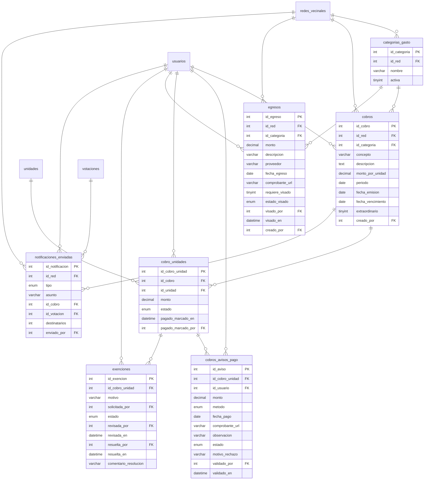
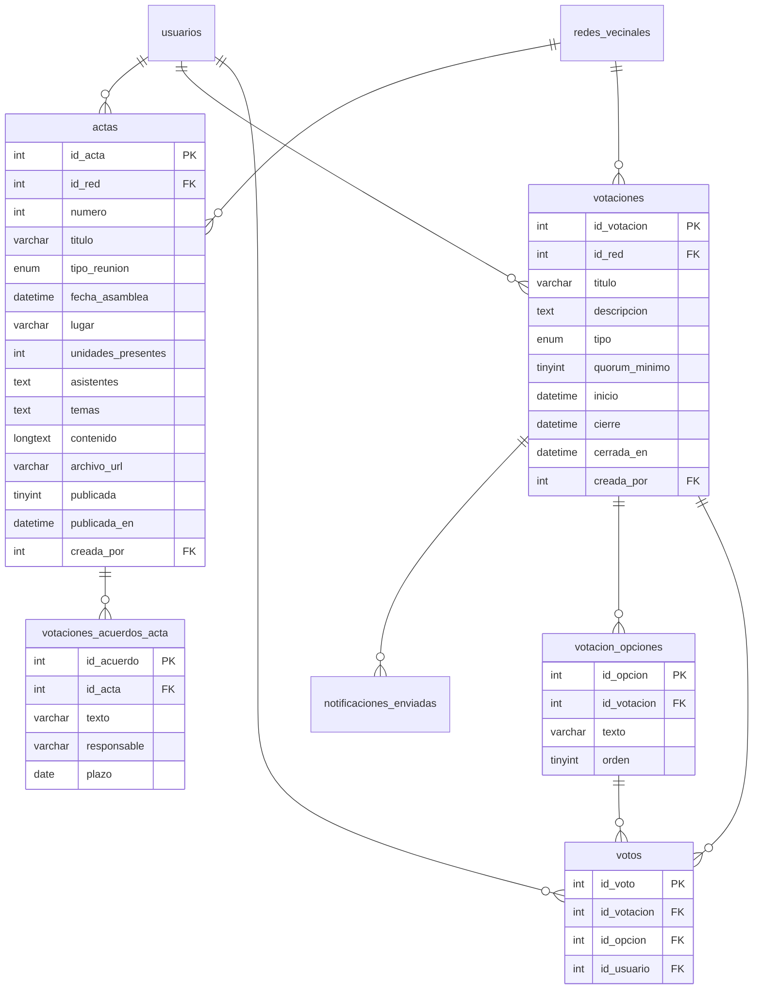
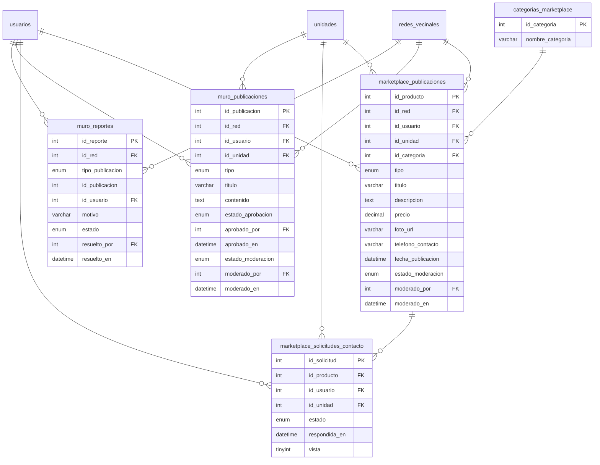
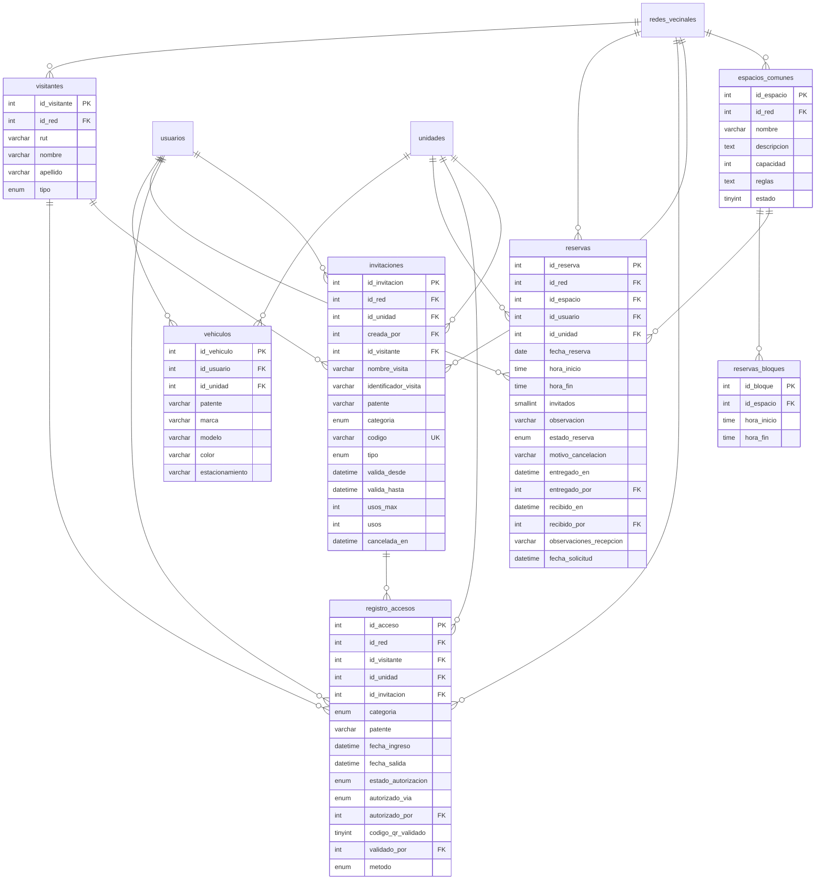

# Modelo de datos

El modelo se implementa en MariaDB y tiene 39 tablas y 91 llaves foráneas. Los diagramas se generaron desde el esquema real de la base de datos. Por claridad omiten las tres fechas de auditoría que tiene cada tabla: `fecha_creacion`, `fecha_actualizacion` y `fecha_eliminacion`.

Convenciones: **PK** es llave primaria, **FK** es llave foránea y **UK** es valor único. Cada diagrama incluye las relaciones de su área, por lo que también aparecen tablas de otras áreas relacionadas con ella.

## Reglas principales
- Un usuario tiene un cargo por fila en `membresias` y una vivienda por fila en `residencias`.
- Cada dato de una comunidad se asocia a `redes_vecinales`.
- Los registros se eliminan con borrado lógico mediante `fecha_eliminacion`.
- `muro_reportes.id_publicacion` no tiene llave foránea, porque apunta al muro o al marketplace según `tipo_publicacion`.
- En el muro y el marketplace, que el autor borre una publicación es un borrado lógico (`fecha_eliminacion`); que la oculte un moderador es `estado_moderacion` = 'Oculta', con `moderado_por` y `moderado_en`.
- `hogar_fichas` pertenece a la unidad: solo la ven y editan sus residentes vigentes.

## Identidad y acceso

```mermaid
erDiagram
    usuarios ||--o{ actas : ""
    usuarios ||--o{ bitacora_auditoria : ""
    usuarios ||--o{ cobros : ""
    usuarios ||--o{ cobros_avisos_pago : ""
    usuarios ||--o{ cobro_unidades : ""
    usuarios ||--o{ codigos_otp : ""
    usuarios ||--o{ comunidad_guias : ""
    usuarios ||--o{ egresos : ""
    usuarios ||--o{ exenciones : ""
    usuarios ||--o{ hogar_fichas : ""
    usuarios ||--o{ invitaciones : ""
    usuarios ||--o{ marketplace_publicaciones : ""
    usuarios ||--o{ marketplace_solicitudes_contacto : ""
    redes_vecinales ||--o{ membresias : ""
    roles ||--o{ membresias : ""
    usuarios ||--o{ membresias : ""
    usuarios ||--o{ muro_publicaciones : ""
    usuarios ||--o{ muro_reportes : ""
    usuarios ||--o{ notificaciones_enviadas : ""
    usuarios ||--o{ redes_vecinales : ""
    usuarios ||--o{ red_modulos : ""
    usuarios ||--o{ registro_accesos : ""
    usuarios ||--o{ reservas : ""
    unidades ||--o{ residencias : ""
    usuarios ||--o{ residencias : ""
    redes_vecinales ||--o{ solicitudes_acceso : ""
    usuarios ||--o{ solicitudes_acceso : ""
    unidades ||--o{ solicitudes_acceso : ""
    usuarios ||--o{ tokens_password : ""
    usuarios ||--o{ vehiculos : ""
    usuarios ||--o{ votaciones : ""
    usuarios ||--o{ votos : ""
    usuarios {
        int id_usuario PK
        varchar identificador
        char pais
        varchar nombre
        varchar primer_apellido
        varchar segundo_apellido
        varchar correo UK
        varchar telefono
        varchar password_hash
        datetime password_actualizada_en
        tinyint es_plataforma
        tinyint bloqueado
        varchar motivo_bloqueo
        tinyint tutorial_app_visto
        tinyint tutorial_panel_visto
    }
    roles {
        int id_rol PK
        varchar nombre_rol UK
    }
    membresias {
        int id_membresia PK
        int id_usuario FK
        int id_red FK
        int id_rol FK
        tinyint activo
        date desde
        date hasta
    }
    residencias {
        int id_residencia PK
        int id_usuario FK
        int id_unidad FK
        enum tipo
        date desde
        date hasta
        datetime fecha_guia_vista
    }
    solicitudes_acceso {
        int id_solicitud PK
        int id_red FK
        int id_unidad FK
        varchar numero_unidad
        enum tipo_residencia
        varchar identificador
        char pais
        varchar nombre
        varchar primer_apellido
        varchar segundo_apellido
        varchar correo
        varchar telefono
        varchar mensaje
        enum estado
        varchar motivo_rechazo
        datetime fecha_solicitud
        datetime fecha_resolucion
        int id_usuario_resolutor FK
        int id_usuario_creado FK
    }
    codigos_otp {
        int id_codigo PK
        int id_usuario FK
        char codigo_hash
        datetime expira
        tinyint usado
        tinyint intentos
    }
    tokens_password {
        int id_token PK
        int id_usuario FK
        char token_hash UK
        enum tipo
        datetime fecha_expiracion
        datetime fecha_uso
    }
```

## Comunidad

```mermaid
erDiagram
    redes_vecinales ||--o{ actas : ""
    redes_vecinales ||--o{ bitacora_auditoria : ""
    usuarios ||--o{ bitacora_auditoria : ""
    redes_vecinales ||--o{ categorias_gasto : ""
    redes_vecinales ||--o{ cobros : ""
    unidades ||--o{ cobro_unidades : ""
    redes_vecinales ||--o{ comunidad_contactos : ""
    redes_vecinales ||--o| comunidad_guias : ""
    usuarios ||--o{ comunidad_guias : ""
    redes_vecinales ||--o{ egresos : ""
    redes_vecinales ||--o{ espacios_comunes : ""
    unidades ||--o{ hogar_fichas : ""
    usuarios ||--o{ hogar_fichas : ""
    redes_vecinales ||--o{ invitaciones : ""
    unidades ||--o{ invitaciones : ""
    redes_vecinales ||--o{ marketplace_publicaciones : ""
    unidades ||--o{ marketplace_publicaciones : ""
    unidades ||--o{ marketplace_solicitudes_contacto : ""
    redes_vecinales ||--o{ membresias : ""
    redes_vecinales ||--o{ muro_publicaciones : ""
    unidades ||--o{ muro_publicaciones : ""
    redes_vecinales ||--o{ muro_reportes : ""
    redes_vecinales ||--o{ notificaciones_enviadas : ""
    usuarios ||--o{ redes_vecinales : ""
    redes_vecinales ||--o{ red_modulos : ""
    usuarios ||--o{ red_modulos : ""
    modulos ||--o{ red_modulos : ""
    unidades ||--o{ registro_accesos : ""
    redes_vecinales ||--o{ registro_accesos : ""
    redes_vecinales ||--o{ reservas : ""
    unidades ||--o{ reservas : ""
    unidades ||--o{ residencias : ""
    redes_vecinales ||--o{ solicitudes_acceso : ""
    unidades ||--o{ solicitudes_acceso : ""
    redes_vecinales ||--o{ unidades : ""
    unidades ||--o{ vehiculos : ""
    redes_vecinales ||--o{ visitantes : ""
    redes_vecinales ||--o{ votaciones : ""
    redes_vecinales {
        int id_red PK
        varchar nombre
        enum tipo
        varchar direccion
        enum estado
        varchar motivo_suspension
        int creada_por FK
        datetime ultima_actividad
        varchar banco
        varchar tipo_cuenta
        varchar numero_cuenta
        varchar titular_cuenta
        varchar identificador_titular
        varchar correo_transferencias
        decimal umbral_visado
    }
    unidades {
        int id_unidad PK
        int id_red FK
        varchar numero_identificador
        enum tipo
        varchar calle_pasaje
        varchar torre
        varchar torre_clave
        smallint piso
        varchar manzana
        int orden
        varchar estacionamiento
    }
    modulos {
        varchar codigo PK
        varchar nombre
        varchar descripcion
    }
    red_modulos {
        int id_red PK
        varchar codigo_modulo PK
        tinyint activo
        int actualizado_por FK
    }
    comunidad_contactos {
        int id_contacto PK
        int id_red FK
        varchar nombre
        varchar detalle
        varchar telefono
        varchar horario
        tinyint visible
    }
    comunidad_guias {
        int id_red PK
        varchar mensaje
        set basura_dias
        varchar basura_horario
        varchar basura_lugar
        varchar reciclaje_lugar
        varchar reciclaje_detalle
        int actualizado_por FK
    }
    hogar_fichas {
        int id_ficha PK
        int id_unidad FK
        enum tipo
        varchar titulo
        text detalle
        varchar contacto_nombre
        varchar contacto_telefono
        date fecha
        date fecha_vence
        int creado_por FK
    }
    bitacora_auditoria {
        int id_bitacora PK
        enum ambito
        int id_red FK
        int id_usuario FK
        varchar accion
        varchar entidad
        int id_entidad
        longtext detalle
    }
```

## Finanzas

## Directiva

## Muro y marketplace

## Reservas y accesos

