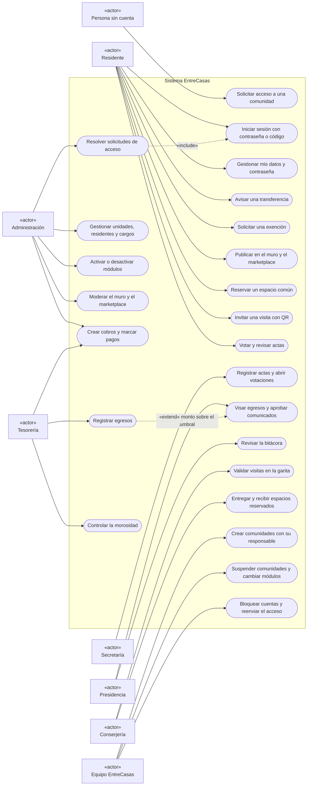
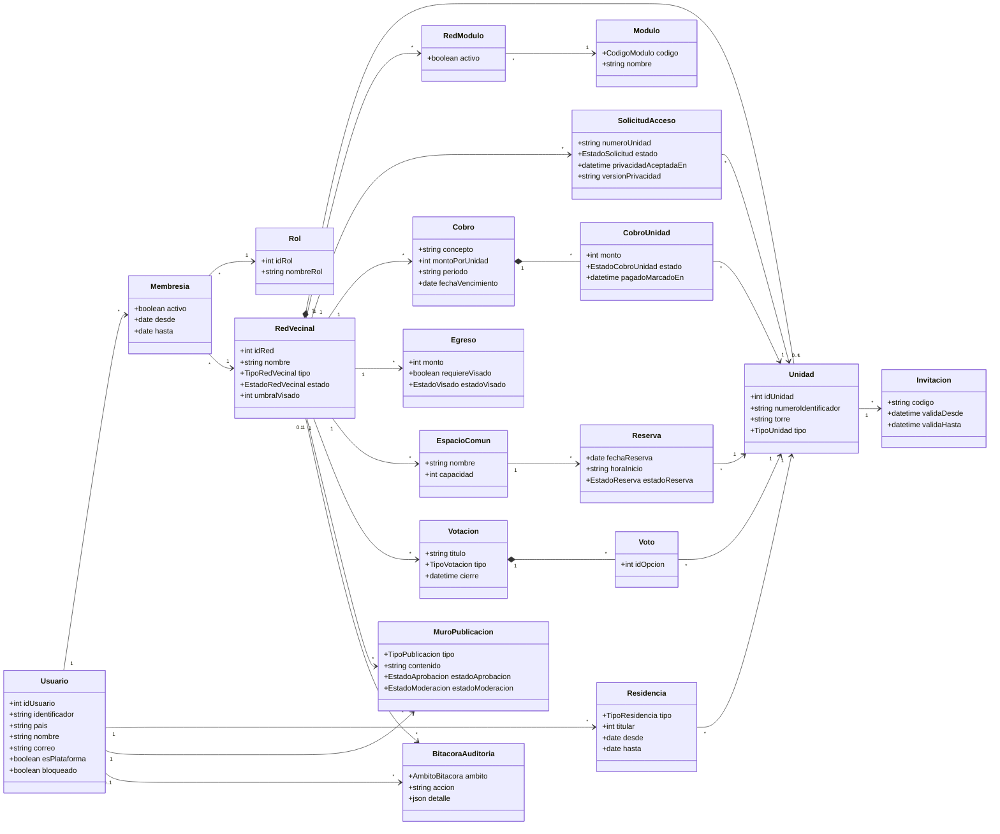
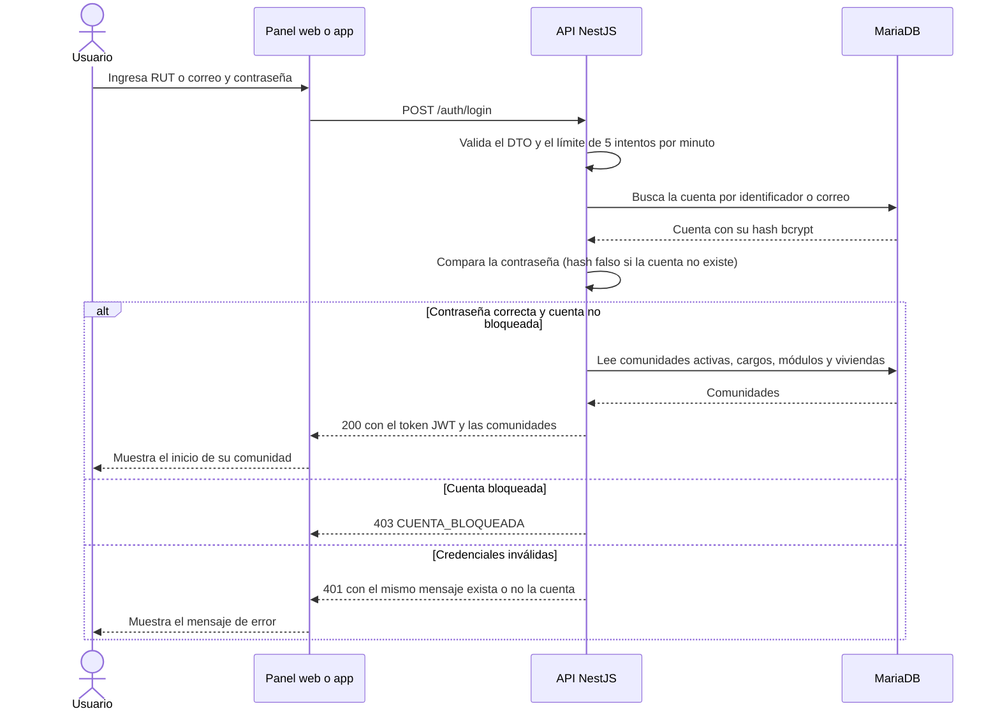
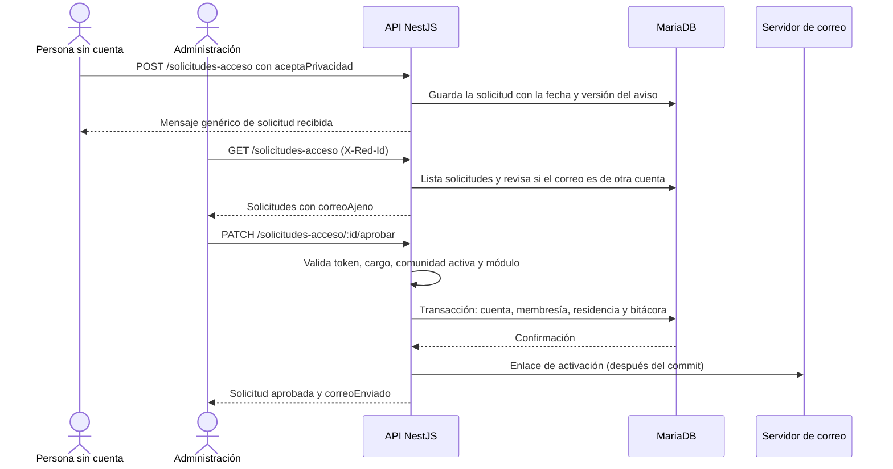
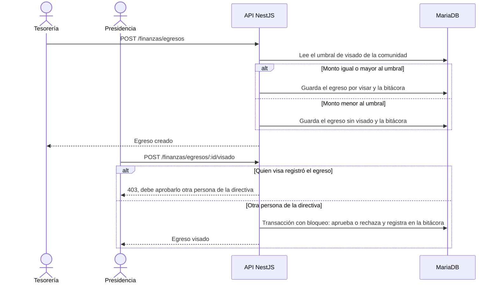
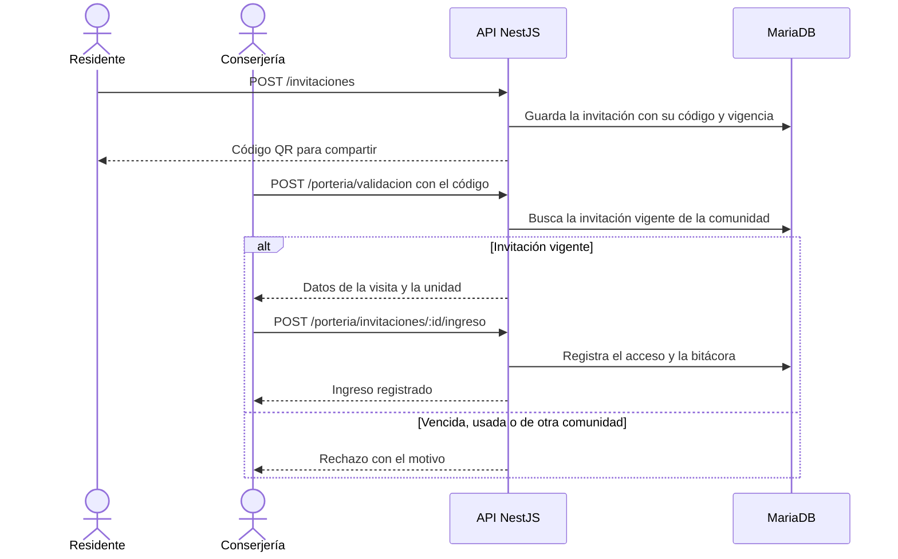
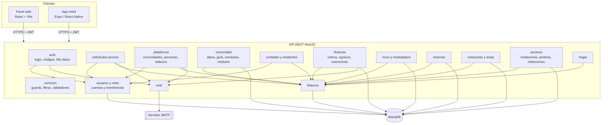

# Diagramas UML

Este documento reúne los cuatro tipos de diagramas UML del sistema: casos de uso, clases, secuencia y componentes. Cada diagrama está escrito en Mermaid, para que GitHub lo muestre directamente, y también se exportó como imagen en la carpeta [diagramas](diagramas/).

| Diagrama | Imagen |
|---|---|
| Casos de uso | [uml-casos-de-uso.png](diagramas/uml-casos-de-uso.png) |
| Clases del dominio | [uml-clases.png](diagramas/uml-clases.png) |
| Secuencia: inicio de sesión | [uml-secuencia-inicio-sesion.png](diagramas/uml-secuencia-inicio-sesion.png) |
| Secuencia: aprobación de una solicitud de acceso | [uml-secuencia-aprobacion-solicitud.png](diagramas/uml-secuencia-aprobacion-solicitud.png) |
| Secuencia: egreso con visado de la Presidencia | [uml-secuencia-egreso-visado.png](diagramas/uml-secuencia-egreso-visado.png) |
| Secuencia: visita con invitación QR | [uml-secuencia-visita-qr.png](diagramas/uml-secuencia-visita-qr.png) |
| Componentes | [uml-componentes.png](diagramas/uml-componentes.png) |

## Casos de uso

Los actores son los seis cargos de una comunidad, el equipo EntreCasas (Plataforma) y la persona que todavía no tiene cuenta. La Presidencia hereda los casos de la Administración cuando la comunidad no contrata un administrador externo.

## Clases del dominio

Las clases corresponden a las entidades de TypeORM del backend. Se muestran los atributos principales y las relaciones con su multiplicidad.

## Secuencia: inicio de sesión

## Secuencia: aprobación de una solicitud de acceso

## Secuencia: egreso con visado de la Presidencia

## Secuencia: visita con invitación QR

## Componentes

Cada componente de la API es un módulo de NestJS. Los clientes solo hablan con la API por HTTP con JWT; los módulos comparten los guards, filtros y validadores de `common` y registran sus cambios en la bitácora.

