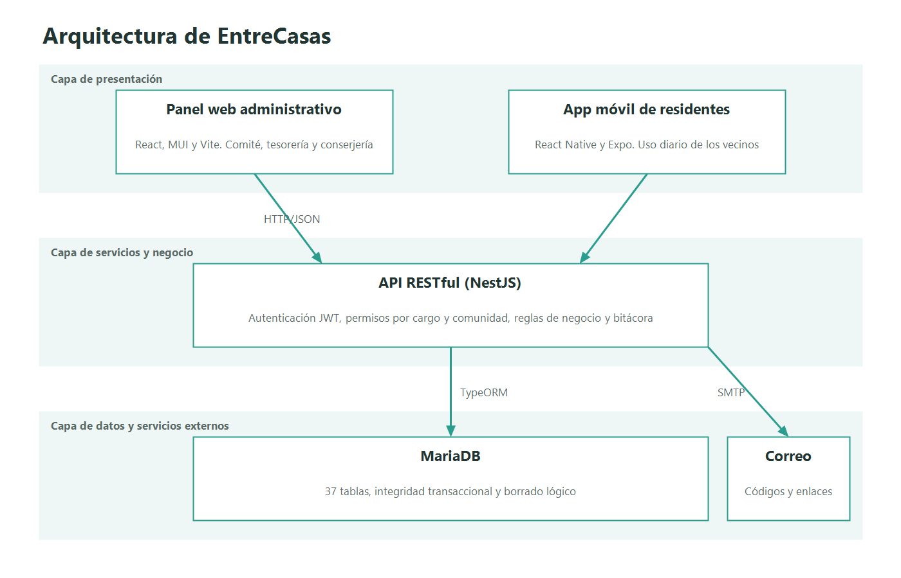

# EntreCasas
Tu comunidad en tu bolsillo.

## Descripción
"EntreCasas" es una plataforma SaaS integral diseñada para modernizar la administración de condominios, villas y edificios de departamentos, y fomentar la cohesión social entre sus residentes. El sistema resuelve la fragmentación de la comunicación vecinal (habitualmente dispersa en grupos informales de mensajería), la falta de transparencia en los cobros administrativos y la ineficiencia en el control de accesos y la reserva de espacios comunes.

El ecosistema articula la gestión operativa, financiera y social mediante dos interfaces principales:

1. Panel web administrativo: diseñado para el comité de administración y la conserjería, orientado a la gestión de comunidades, unidades y residentes, el cobro de gastos comunes, el control de morosidad y el monitoreo de accesos.
2. Aplicación móvil para residentes: diseñada para el uso diario de los vecinos, permite ver los comunicados del Muro Vecinal, participar en el Marketplace comunitario, gestionar el perfil y reservar espacios comunes.

La plataforma no procesa pagos: el Tesorero o el Administrador crean los cobros y marcan manualmente quién pagó, y el residente solo puede avisar que ya transfirió.

## Tecnologías
- Frontend web: React 19, Material UI (MUI), React Router, Vite.
- Frontend móvil: React Native, Expo, Expo Router, TypeScript.
- Backend: NestJS 12 (Node.js, TypeScript), TypeORM, JWT con Passport, bcrypt, Nodemailer, Jest.
- Base de datos: MariaDB, administrada con Laragon y HeidiSQL.
- Infraestructura y herramientas: Git y GitHub (control de versiones). Planificado: Docker (contenerización, al finalizar el proyecto) y Vercel/Render (despliegue en la nube).

## Estructura del repositorio
```text
FASE 1/, FASE-2/, FASE-3/         Evidencias académicas de cada fase
FASE-2/Evidencias-Proyecto/Sistema/
├── backend/                      API NestJS
├── bd/entrecasas_db.sql          Script que crea la base de datos
└── frontend/
    ├── web-admin/                Panel web administrativo
    └── mobile-residentes/        Aplicación móvil para residentes
```

## Estado actual
- Backend implementado:
    - Identidad: autenticación con contraseña o código por correo, recuperación de contraseña y solicitudes de acceso.
    - Plataforma: comunidades, módulos y alta de comunidades.
    - Comunidad: unidades, residentes y cargos, Mi hogar, guía de bienvenida y contactos.
    - Finanzas: cobros, pagos, avisos, morosidad, egresos con visado, exenciones y reportes.
    - Convivencia: Muro Vecinal con comunicados, aprobación y moderación, y reservas de espacios comunes con entrega y recepción en conserjería.
    - Directiva: votaciones y encuestas con un voto por vivienda emitido por el titular, y libro de actas.
    - Transversal: bitácora de auditoría y un formato único de errores.
- Backend pendiente: marketplace, invitaciones QR y conserjería, y los datos de la comunidad (cuenta de transferencia y umbral de visado).
- Base de datos: esquema completo de 39 tablas y 93 llaves foráneas.
- Pruebas: 1176 pruebas unitarias aprobadas, con 89 % de cobertura de sentencias.
- Panel web y aplicación móvil: las vistas están construidas, pero **todavía no se conectan al backend**. Funcionan con datos de prueba y las cuentas de demostración se muestran en la pantalla de inicio de sesión.

## Ejecución local
1. Requisitos previos.
    - Node.js 22.13 o superior (o 24.3 o superior) y npm.
    - Laragon con MariaDB 10.10 o superior. El MariaDB 10.4 de XAMPP no sirve.
    - Expo Go en el móvil.
2. Clonar el repositorio y entrar a la carpeta del sistema.
    ```bash
    git clone https://github.com/JonasMateosValenzuelaLopez/ProyectoTesis.git
    cd ProyectoTesis/FASE-2/Evidencias-Proyecto/Sistema
    ```
3. Crear la base de datos. MariaDB debe trabajar en UTC: en Laragon, abrir `my.ini` (menú MySQL → my.ini), agregar `default-time-zone='+00:00'` bajo `[mysqld]` y reiniciar MariaDB; sin esto la API no arranca. Con MariaDB encendido, abrir HeidiSQL y ejecutar `bd/entrecasas_db.sql` (Archivo → Ejecutar archivo SQL, codificación UTF-8). El script borra y recrea `entrecasas_db`.
4. Configurar y ejecutar el backend.
    ```bash
    cd backend
    npm install
    cp .env.example .env
    npm run start:dev
    ```
    Antes de ejecutar, completar `JWT_SECRET` en `.env`. La API queda en http://localhost:3000. Sin `SMTP_HOST` no se envían correos: con `NODE_ENV=development` se imprimen en la consola.
5. Ejecutar el panel web administrativo, desde `Sistema` en otra terminal.
    ```bash
    cd frontend/web-admin
    npm install
    npm run dev
    ```
    El panel queda en http://localhost:5173.
6. Ejecutar la aplicación móvil, desde `Sistema` en otra terminal, y escanear el código QR con Expo Go.
    ```bash
    cd frontend/mobile-residentes
    npm install
    npx expo start -c
    ```

### Otros comandos del backend
```bash
npm test             # pruebas unitarias
npm run test:cov     # cobertura
npm run lint         # análisis estático
npm run build        # compilación
```

## Integrantes y roles
| Integrante       | Rol Scrum     | Área técnica                                 |
|------------------|---------------|----------------------------------------------|
| Camila Retamal   | Scrum Master  | Desarrollo backend e implementación de la BD |
| Jonas Valenzuela | Product Owner | Desarrollo frontend y diseño del modelo de datos |

Ambos integrantes forman además el equipo de desarrollo.

## Metodología
Se seleccionó la metodología ágil Scrum. Esta elección permite estructurar el desarrollo incremental del software en Sprints, facilitar la detección y resolución de bloqueos técnicos y asegurar la entrega continua de un Producto Mínimo Viable (PMV).

El proyecto comenzó el 22 de agosto de 2026 y se entrega el 11 de noviembre de 2026. Los Sprints se ajustaron al avance real:

| Sprint   | Período          | Alcance                                                                                                    | Estado     |
|----------|------------------|------------------------------------------------------------------------------------------------------------|------------|
| Sprint 0 | 22 ago. al 5 sep. | Definición del proyecto, objetivos, stack tecnológico, arquitectura y repositorio.                         | Terminado  |
| Sprint 1 | 6 sep. al 17 oct. | Requerimientos, flujos UI/UX y diseño del modelo de datos, a ritmo reducido por la práctica profesional.   | Terminado  |
| Sprint 2 | 18 al 31 oct.    | Identidad y seguridad: esquema de la base de datos, autenticación, solicitudes de acceso, bitácora y vistas web y móvil. | Terminado  |
| Sprint 3 | 1 al 4 nov.      | Comunidad e integración: comunidades, unidades y residentes, y conexión de las vistas con la API.           | Backend terminado; falta conectar las vistas |
| Sprint 4 | 5 al 8 nov.      | Finanzas y convivencia: cobros, morosidad, Muro Vecinal y Marketplace.                                      | En curso   |
| Sprint 5 | 9 al 11 nov.     | Reservas y accesos con código QR, Docker, despliegue y pruebas finales.                                     | Pendiente  |

Los documentos de la metodología están en la carpeta `FASE-2/Evidencias-Proyecto/Documentación/`: [Product Vision](FASE-2/Evidencias-Proyecto/Documentación/01-product-vision.md), [Product Backlog](FASE-2/Evidencias-Proyecto/Documentación/02-product-backlog.md), [Sprint Backlog](FASE-2/Evidencias-Proyecto/Documentación/03-sprint-backlog.md), [Definition of Done](FASE-2/Evidencias-Proyecto/Documentación/04-definition-of-done.md) y [Retrospectivas](FASE-2/Evidencias-Proyecto/Documentación/05-retrospectivas.md).

## Documentación
Documentación técnica:

- [Arquitectura](FASE-2/Evidencias-Proyecto/Documentación/06-arquitectura.md)
- [Modelo de datos](FASE-2/Evidencias-Proyecto/Documentación/07-modelo-datos.md)
- [Diagramas UML](FASE-2/Evidencias-Proyecto/Documentación/08-diagramas-uml.md)
- [Requisitos no funcionales](FASE-2/Evidencias-Proyecto/Documentación/09-requisitos-no-funcionales.md)
- [Plan de pruebas](FASE-2/Evidencias-Proyecto/Documentación/10-plan-pruebas.md)
- [Manual técnico](FASE-2/Evidencias-Proyecto/Documentación/11-manual-tecnico.md), que incluye el despliegue y Docker
- [Innovación](FASE-2/Evidencias-Proyecto/Documentación/12-innovacion.md)

Evidencias académicas:

- [FASE 1](FASE%201): definición del proyecto, objetivos, plan de trabajo y Carta Gantt.
- [FASE-2](FASE-2): desarrollo del proyecto, avance e informe final.
- [FASE-3](FASE-3): presentación final, diario de reflexión y autoevaluación.

## Arquitectura


La solución sigue una arquitectura en capas, con un backend modular único que expone una API RESTful:

- Capa de presentación: cliente web SPA (React) y cliente móvil (React Native + Expo).
- Capa de servicios y negocio: API RESTful en NestJS que procesa la autenticación, la autorización basada en cargos (RBAC) por comunidad, el control de accesos y la emisión de cobros.
- Capa de datos: motor relacional MariaDB, encargado de garantizar la integridad transaccional (ACID) en cobros, reservas y relaciones jerárquicas de viviendas.
